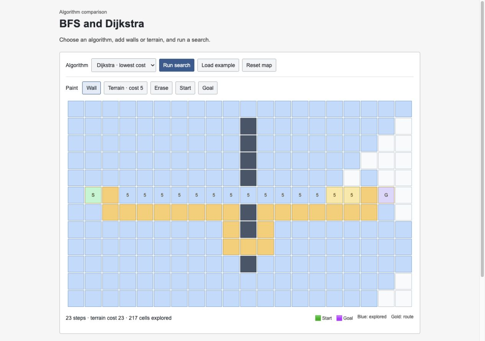

# Pathfinder Lab

A JavaScript grid for comparing breadth-first search and Dijkstra's algorithm. Add walls and weighted terrain, then compare the route, cost, and number of explored cells.



## Try it

Serve the project folder with Python 3:

```sh
python3 -m http.server 8000 --bind 127.0.0.1
```

Open <http://127.0.0.1:8000>. The page uses JavaScript modules, so opening `index.html` directly is not enough. There are no packages to install.

Click **Load example**, run **BFS**, then run **Dijkstra** on the same map. BFS takes the route with fewer steps; Dijkstra can take a longer route that costs less. Use the paint tools to change the map or move its start and goal.

## How the search works

Moves go up, right, down, or left. A wall is blocked, a normal cell costs 1, and painted terrain costs 5. The cost is paid when entering a cell; the start costs nothing.

`src/search.js` contains both algorithms without any page code. BFS uses a queue and minimizes the number of moves. Dijkstra tracks the cheapest known cost and picks the lowest-cost frontier cell next. It uses a linear scan instead of a priority queue, keeping the code short at the cost of O(V²) worst-case time. BFS takes O(V + E); both use O(V) space.

`src/app.js` handles the 12 × 20 map and displays the results. Editing clears the previous search, and refreshing resets the map. Cells and controls work with a keyboard, and animations respect reduced-motion settings.

## Tests

With Node.js 22 or newer:

```sh
npm test
```

Tests check routes on uniform and weighted grids, blocked goals, boundaries, invalid input, and whether a search leaves the original grid unchanged. CI runs them on Node 22 and 24.

## Limits

The interface is for small maps. The search module accepts up to 10,000 cells, but Dijkstra's linear frontier becomes slow on large grids. It has no diagonal movement, saved maps, or map import. Narrow screens can scroll the grid horizontally.

[MIT license](LICENSE)
